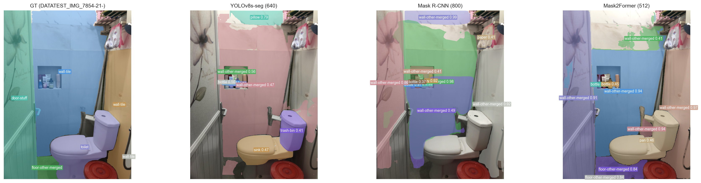
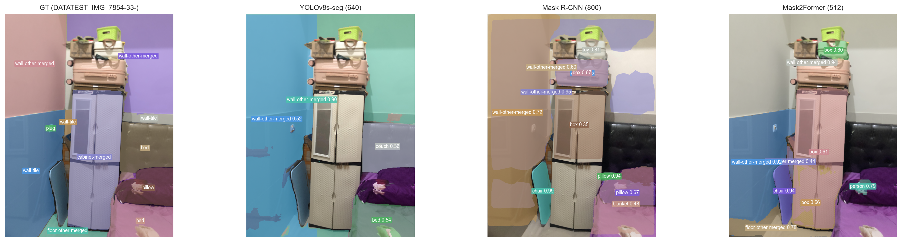
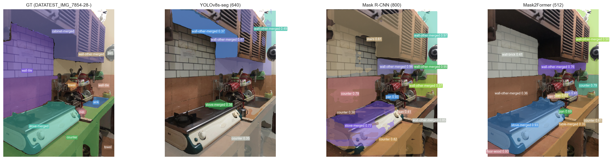
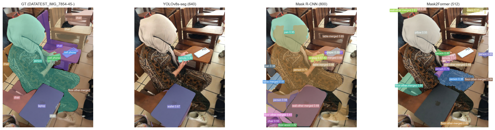
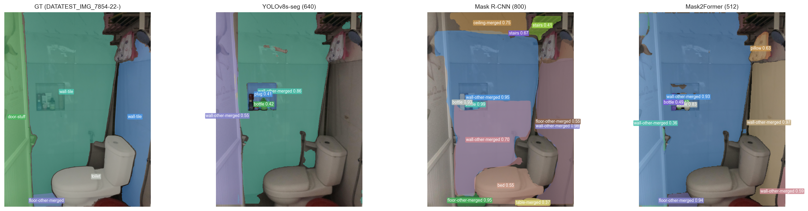
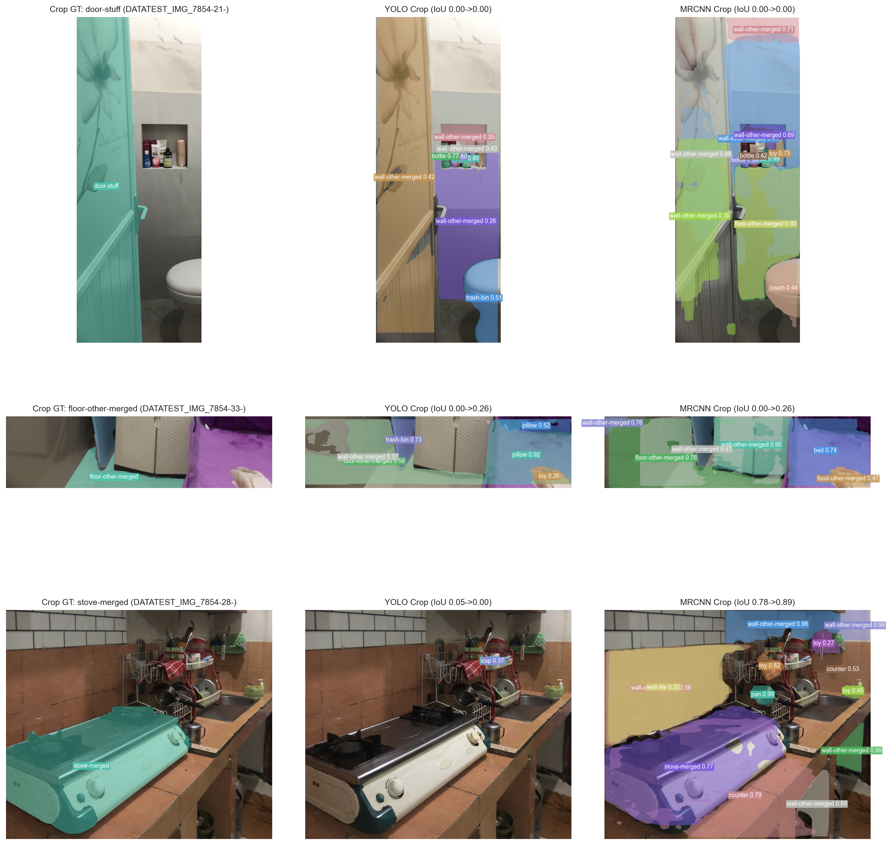

# 4. Analisis Kegagalan Berbasis Bukti & Eksperimen Pembuktian

Dari audit otomatis seluruh 44 foto pada `custom_failure_audit_44photos.csv`, dipilih **5 studi kasus foto tersulit** yang memuat beragam mode kegagalan (tidak terdeteksi, mask bocor/kasar, salah kelas, dan objek terpecah).

## 5 Studi Kasus Kegagalan pada Custom Test Set

### Kasus 1: Kamar Mandi Terang (`DATATEST_IMG_7854-21-`)
- **Kegagalan:** `toilet` dan `wall-tile` gagal terdeteksi atau salah kelas menjadi `wall-other-merged` dan `sink`.
- **Kaitan mekanisme model:** Kelas `toilet` sangat langka di data latih (2 sampel), sementara permukaan keramik tanpa batas tegas membingungkan klasifikasi *query* Mask2Former dan proposal RPN Mask R-CNN.

### Kasus 2: Sudut Kamar Kos Malam & Oklusi Barang (`DATATEST_IMG_7854-33-`)
- **Kegagalan:** Lemari yang tertutup koper/kardus gagal terdeteksi di YOLOv8s-seg, sedangkan di Mask R-CNN mask lemari bocor dan terpecah.
- **Kaitan mekanisme model:** Oklusi berat menggeser titik pusat objek pada grid deteksi YOLOv8 dan membatasi kualitas mask `28x28` pada RoIAlign Mask R-CNN.

### Kasus 3: Dapur Padat dengan Oklusi Berat (`DATATEST_IMG_7854-28-`)
- **Kegagalan:** Kisi kayu kabinet salah diklasifikasikan sebagai `door-stuff` atau `chair`, dan kompor/botol kecil sebagian terlewat.
- **Kaitan mekanisme model:** Tekstur garis vertikal lemari memicu fitur konvolusi CNN yang mirip pintu/sandaran kursi, sedangkan resolusi *prototype mask* `160x160` YOLOv8 kurang tajam untuk sela-sela benda dapur yang rapat.

### Kasus 4: Ruang Kelas Sudut Atas Ekstrem (`DATATEST_IMG_7854-45-`)
- **Kegagalan:** Objek yang diambil dari sudut *high-angle* (`person`, `chair`, `potted plant`, `door-stuff` kecil di kejauhan) banyak tidak terdeteksi.
- **Kaitan mekanisme model:** Perspektif dari atas jarang muncul di dataset latih dan membuat ukuran piksel objek di ujung ruangan menjadi sangat kecil saat gambar diperkecil ke `640` atau `512` piksel.

### Kasus 5: Kamar Mandi Cahaya Redup ISO 200 (`DATATEST_IMG_7854-22-`)
- **Kegagalan:** Pasangan foto redup dari Kasus 1; jumlah deteksi turun lebih jauh karena skor keyakinan jatuh di bawah *threshold* `0.35`.
- **Kaitan mekanisme model:** Kontras tepi objek menurun dan *noise* sensor meningkat di kondisi gelap sehingga probabilitas kelas tidak melewati batas `conf=0.35`.

---

## Hasil Eksperimen Kecil Pembuktian

### Eksperimen Kecil A: Uji Resolusi Input vs Confidence Threshold (`mini_experiment_A_res_and_conf.csv`)
| Model | Perlakuan | Rata-rata Objek Cocok (`IoU>=0.50`) | Rata-rata `Recall@50` | Rata-rata `Mean IoU` |
| :--- | :--- | :---: | :---: | :---: |
| **YOLOv8s-seg** | Baseline (`imgsz=640`, `conf=0.35`) | 0.80 | 0.0850 | 0.0888 |
| **YOLOv8s-seg** | Resolusi Tinggi (`imgsz=1280`, `conf=0.35`) | 0.60 | 0.0734 | 0.0718 |
| **YOLOv8s-seg** | Threshold Rendah (`imgsz=640`, `conf=0.15`) | **1.60** | **0.1732** | **0.1674** |
| **Mask R-CNN** | Baseline (`min=800`, `conf=0.35`) | 1.40 | 0.1456 | 0.1230 |
| **Mask R-CNN** | Resolusi Tinggi (`min=1200`, `conf=0.35`) | 1.60 | 0.1638 | 0.1530 |
| **Mask R-CNN** | Threshold Rendah (`min=800`, `conf=0.15`) | **2.00** | **0.2072** | **0.2122** |

Menurunkan *confidence threshold* ke `0.15` menggandakan jumlah objek yang berhasil ditemukan pada foto gelap dan terhalang, membuktikan bahwa banyak objek sebenarnya terdeteksi tetapi skornya tertahan di rentang `0.15 - 0.34`.

### Eksperimen Kecil B: Uji Zoom-In / Crop Objek Gagal (`mini_experiment_B_zoom_crop.csv`)
Memotong area sekitar objek kecil/sedang yang sebelumnya gagal (`IoU = 0.00`) menaikkan akurasi mask secara drastis (misalnya `potted plant` pada Kasus 4 naik dari `0.00` menjadi `0.86` di YOLOv8s-seg dan Mask R-CNN; `pillow` pada Kasus 2 di Mask R-CNN naik dari `0.00` menjadi `0.87`), membuktikan keterbatasan skala fitur objek kecil dan resolusi grid mask `28x28`.

